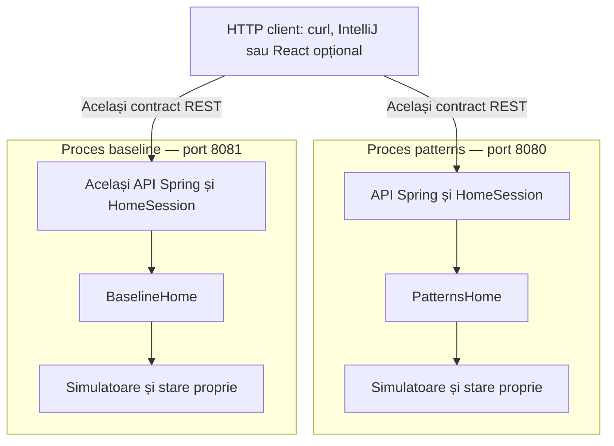
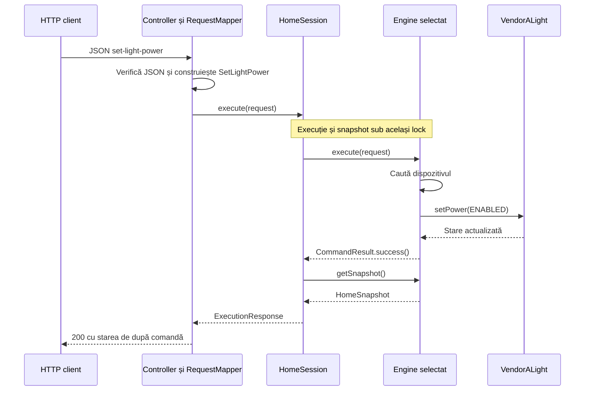
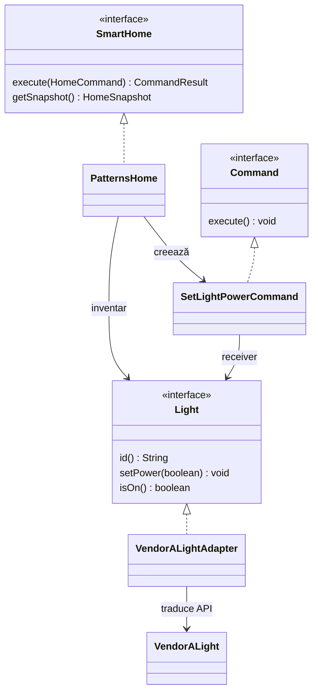
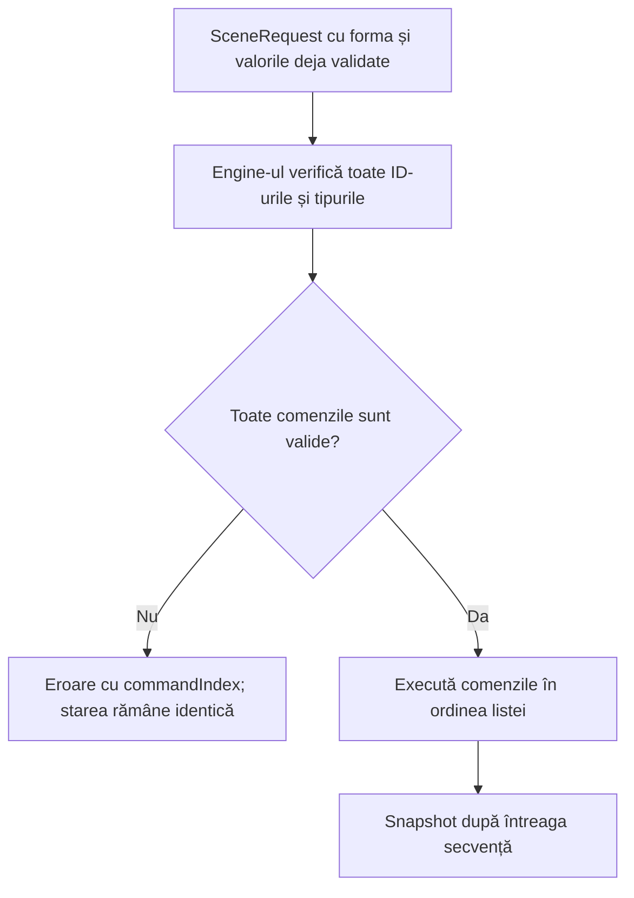

# Arhitectura proiectului Smart Home

## 1. Ce construim și de ce

Construim un simulator local de casă inteligentă: putem aprinde un bec, seta temperatura și executa o listă de acțiuni, de exemplu „plec de acasă”. Nu avem nevoie de dispozitive reale.

Același comportament este implementat de două ori:
- **baseline**: control direct, centralizat, cu metode și ramificații obișnuite;
- **patterns**: responsabilități separate prin patterns justificate de problemă.

Scopul SASPS este să comparăm costul și beneficiile acestor alegeri: cât cod adaugă, unde se modifică o funcționalitate, ce regresii apar și ce cost au la execuție. Ulterior comparăm și implementarea unei extensii de către același model AI. Nu construim intenționat un baseline defect și nu presupunem că patterns câștigă la toate metricile.

**Pentru un coleg nou:** citește secțiunile 2–5 pentru imaginea de ansamblu, apoi [contractul v1](contracts-v1.md) și [taskul tău din S1](tasks-sprint-1.md). Contractul conține formele exacte de JSON și reguli; acest document explică de ce și unde se implementează.

## 2. Ce există acum și care este ținta

| Zonă | Implementat acum | Ținta Sprintului 1 | După S1 |
| --- | --- | --- | --- |
| Aplicație | Java 21, Spring Boot, API REST și OpenAPI static | Păstrăm aceeași infrastructură | React este opțional |
| Dispozitive | Bec Vendor A, on/off | Bec și termostat Vendor A; temperatură în Celsius | Al doilea producător în S2 |
| Comenzi | Controlul becului în ambele engines | Control identic pentru ambele dispozitive | Extensii rezervate evaluării |
| Scenarii | Tipuri și validări; execuția validă întoarce 501 | Listă plată de 1–50 comenzi, validată integral înainte de execuție | Scenarii imbricate în S2 |
| Patterns | Command și Adapter pentru bec | Command, Adapter și compunere prin SceneCommand | Observer și Strategy în S2 |
| Evaluare | Teste comune core și HTTP; CI | Contor LOC, măsurători inițiale și demo | Pilot AI în S2, evaluare finală în S3 |

**Termostatul și execuția scenariilor nu sunt încă funcționale.** Tipurile există, dar cererile valide pentru aceste features întorc explicit `501 NOT_IMPLEMENTED`. Diagramele marcate „țintă S1” descriu implementarea de realizat, nu cod deja livrat.

Planul S2 este direcția de extindere din [scope](scope.md). API-urile noi pentru senzori, automatizări și nesting se fixează la planificarea S2. Nu le inventăm în stories S1. Acestea sunt decizii ale echipei, nu cerințe suplimentare atribuite profesorului.

## 3. Imagine de ansamblu la rulare

**Stadiu: funcționează acum pentru bec.** Același JAR se pornește în două procese numai când vrem să comparăm variantele:

Nu sunt microservicii și nu comunică între ele. Sunt două rulări independente ale aceleiași aplicații, cu configurări diferite. În development este suficient să pornești varianta relevantă.

`HomeConfiguration` citește `smart-home.variant` la startup și expune o singură instanță `SmartHome`: `PatternsHome` sau `BaselineHome`. Alegerea nu se schimbă prin request. Varianta implicită este patterns; o valoare necunoscută oprește pornirea.

Fiecare proces păstrează o singură casă în memorie; restartul resetează starea. În ținta S1, inventarul inițial este `living-light` oprit și `living-thermostat` la 20.0°C. În starter există doar becul.

Nu avem DB, broker, conturi, cloud sau hardware în MVP. Un eventual React este doar un client al API-ului; nu schimbă engines.

## 4. Componente, module și limite

Structura este modulară, cu straturi și o interfață de intrare `SmartHome`. La integrarea API-urilor producătorilor, varianta patterns folosește adaptoare. Modulele Maven sunt separări de cod, nu servicii distribuite.

| Modul / componentă | Responsabilitate | Limită importantă |
| --- | --- | --- |
| `shared/contracts` | HomeCommand, SceneRequest, CommandResult, snapshots, SmartHome și constrângeri de valori | Java simplu; fără Spring/Jackson, dispozitive de producător sau orchestrare |
| `shared/simulators` | API-uri fictive Vendor A, cu stare în fiecare obiect | Simulează dispozitive; nu decide scene/politici |
| `implementations/baseline` | BaselineHome: inventar, validare de inventar și control direct | Nu folosește clasele din patterns |
| `implementations/patterns` | PatternsHome, interfețe de dispozitive, adaptoare și comenzi executabile | Nu folosește clasele din baseline |
| `server` | Spring DI, transport HTTP, JSON, erori și HomeSession | Fără logica comparată de scenarii sau politici |
| `app` | Demo CLI opțional | Nu este necesar pentru clientul web |
| `acceptance-tests` | Aceleași teste core pentru ambele engines; fixtures comune | Verifică echivalența comportamentală |
| `server/src/test` | Aceleași cazuri HTTP pe servere reale baseline/patterns | Verifică și transportul, validarea și concurența |
| `benchmarks`, `experiments` | Zone rezervate măsurătorilor și experimentelor AI | Runner-ele sunt muncă planificată, nu funcționalitate existentă |

Ambele engines depind de contracts și simulators. Modulul server depinde de ambele engines pentru a-l putea selecta pe cel configurat. Engines nu depind de server și nu se importă reciproc.

În server:
- `HomeController` expune endpoints;
- `RequestMapper` verifică forma JSON și construiește cererile Java;
- `HomeSession` apelează engine-ul și capturează snapshot-ul sub același lock;
- `ApiErrorHandler` transformă erorile în răspunsuri HTTP uniforme;
- `HomeConfiguration` conectează implementarea aleasă la Spring.

**Exemplu de limită:** conversia „22.1°C → 221 deci-grade Vendor A” aparține adaptorului în patterns și controlului direct în baseline. Verificarea că `temperature` este un număr JSON aparține RequestMapper. Validarea că ID-ul există și are tipul potrivit aparține fiecărui engine.

## 5. Drumul unei comenzi

**Stadiu: flux existent pentru bec.** Exemplu: `POST /api/v1/commands` cu `set-light-power`.

În baseline, engine-ul apelează direct simulatorul. În patterns, apelul trece prin `SetLightPowerCommand → Light → VendorALightAdapter → VendorALight`; diagrama de secvență grupează aceste clase în engine pentru lizibilitate.

`HomeSession` serializează accesul la casă. Un request nu poate primi snapshot-ul produs de un alt request care s-a intercalat între comanda sa și citire. Nu garantăm ordinea în care cererile concurente obțin lock-ul. Pentru benchmark direct pe engines folosim execuție controlată, fără cereri HTTP concurente.

| Etapă | Exemplu de eroare | Cine răspunde |
| --- | --- | --- |
| JSON / valori | Câmp lipsă, tip greșit, temperatură invalidă | RequestMapper și constructorii contractelor; ApiErrorHandler produce HTTP |
| Inventar / compatibilitate | ID necunoscut; comandă de temperatură către bec | Engine-ul produce CommandResult; serverul mapează eroarea |
| Feature încă nelivrat | Control termostat sau scenariu valid în starter | Engine-ul întoarce NOT_IMPLEMENTED, HTTP 501 |
| Execuție reușită | Becul este pornit | HomeSession produce răspunsul cu snapshot |

Lista exactă de statusuri și precedența validărilor sunt în [contractul v1](contracts-v1.md#erori).

## 6. Unde apar design patterns

### Structura actuală a controlului becului în patterns

**Stadiu: clase existente în repo.** Săgeata punctată cu triunghi reprezintă implementarea unei interfețe; celelalte arată utilizare sau deținerea unei referințe.

**Două concepte diferite:** `SetLightPower` este un record de cerere din contracts; `SetLightPowerCommand` este un obiect executabil din patterns. Recordul nu este Command Pattern doar pentru că are „command” în nume. Controllerul nu construiește comenzi executabile și nu cunoaște adaptoarele.

Diagrama omite intenționat executeScene și snapshots pentru a arăta doar relațiile relevante controlului becului. Interfața SmartHome completă este în cod.

| Pattern | Unde și când | De ce este justificat | Echivalent baseline |
| --- | --- | --- | --- |
| Command | SetLightPowerCommand există; SetTargetTemperatureCommand în #5 | O acțiune devine obiect executabil, utilizabil și de scenarii | Ramificație pe tipul cererii și apel direct |
| Adapter | VendorALightAdapter există; VendorAThermostatAdapter în #4 | Ascunde enum-ul pentru bec și unitățile de temperatură ale producătorului | Conversii și apeluri vendor în controlul direct |
| Composite | SceneCommand cu o listă de Command, țintă #6 | Permite executarea unei secvențe prin aceeași operație execute | Buclă peste lista de cereri, după prevalidare |
| Observer | Evenimente de senzori și consumatori, plan S2 | Senzorul poate notifica automatizări fără să le cunoască pe fiecare | Actualizare și invocare centralizată |
| Strategy | Două politici de temperatură, plan S2 | Alegerea algoritmului fără a rescrie executorul de automatizări | Alegerea politicii prin ramificații |

SceneCommand este pasul de compunere S1: are numai comenzi-frunză. Nesting-ul și detectarea ciclurilor sunt extensii S2; nu construim anticipat un arbore de scenarii.

Spring DI este mecanismul comun de conectare a componentelor. Faptul că un bean are scope singleton nu reprezintă un avantaj experimental al variantei patterns. Nu adăugăm Singleton, Factory, Bridge sau alte patterns doar pentru a crește numărul lor.

## 7. Cum trebuie să funcționeze un scenariu

**Stadiu: țintă S1, issue #6.** Exemplu: „leave-home” stinge becul și setează termostatul la 18°C.

Regula este identică în ambele engines: întâi verificăm întreaga listă, apoi executăm. O comandă invalidă la indexul 1 nu trebuie să lase efectul comenzii de la indexul 0. Forma și valorile tuturor comenzilor sunt verificate întâi la granița HTTP; apoi engine-ul verifică inventarul.

În patterns, SceneCommand compune comenzile deja validate. În baseline, controlul centralizat parcurge lista după prevalidare. **Prevalidarea inventarului și orchestrarea nu se mută într-un helper comun**, pentru că sunt parte din proiectarea comparată.

Aceasta nu este o tranzacție distribuită: nu avem hardware care poate eșua după un efect fizic și nu promitem rollback/compensări pentru astfel de defecte. Garanția S1 privește respingerea inputului invalid înainte de execuție.

## 8. Alegeri arhitecturale și consecințe

| Alegere | Motiv | Consecință / compromis |
| --- | --- | --- |
| Monolit modular, un JAR | Scope realist și pornire simplă pentru patru colegi | Separarea se menține prin limite de cod și review |
| Două engines, același contract | Comparație pe aceeași problemă | Unele implementări sunt dublate intenționat; se schimbă ambele când story-ul o cere |
| Spring numai în server | Engines pot fi testate și măsurate direct | Maparea transportului este explicită |
| Simulatoare comune | Eliminăm diferențele de hardware/API extern din comparație | Nu pretindem că măsurăm latența dispozitivelor reale |
| Stare în memorie și acces sincronizat | Demo repetabil și snapshot coerent | Restartul pierde starea; o singură operație accesează casa la un moment dat |
| Variantă aleasă la startup | Separare simplă a stărilor și experimentelor | Pentru comparație HTTP pornim două procese |
| Fără infrastructură suplimentară în MVP | Timpul merge în design și evaluare | DB, broker și UI se adaugă numai cu o nevoie explicită |

Pentru o decizie nouă, actualizați contextul, alegerea și consecințele în această secțiune. Modificarea unui endpoint sau a unei reguli publice cere și actualizarea explicită a contractului, nu doar o diagramă nouă.

## 9. Cum verificăm că am construit ce trebuie

Mai întâi verificăm aceleași comportamente în ambele engines cu suita comună. Apoi verificăm prin HTTP că transportul respectă contractul. Abia după echivalență interpretăm diferențele de metrici.

- **S1:** LOC raportat separat pentru engines, comun și teste; workload direct identic, warm-up și rulări repetate. Runner-ul se implementează în #9.
- **S2–S3:** extensie funcțională identică, model/prompt/buget controlate, workspace-uri izolate, teste externe și reset între rulări. Înregistrăm corectitudinea, timpul, tokenii reali disponibili și diff-ul.
- Latența Spring/HTTP se raportează separat. Mai multe clase sau mai puține linii nu demonstrează singure calitate; rezultatele se interpretează cu compromisurile arhitecturale.

Metoda completă și limitele sunt în [evaluare](evaluation.md). Niciun rezultat experimental nu este presupus de această arhitectură.

## 10. Unde începe fiecare contribuție

| Tip de task | Locul principal | Ce trebuie păstrat |
| --- | --- | --- |
| Simulator Vendor A — #3 | shared/simulators | API-ul decis; fără orchestrare |
| Adaptor termostat — #4 | implementations/patterns | Conversii în adaptor; baseline rămâne independent |
| Control manual — #5 | Ambele engines | Același contract și aceleași erori |
| Scenarii — #6 | Ambele engines | Prevalidare integrală; execuție în ordine |
| Integrare REST — #7 | server și exemple HTTP | Fără mutarea logicii engines în controller |
| Teste / metrici — #8 și #9 | acceptance-tests, server/src/test și benchmarks | Corectitudine comună; măsurare directă separată de HTTP |
| Onboarding / demo — #10 și #11 | Documentație și exemple | Pași reproductibili și descrierea stadiului real |

Taskurile complete, dependențele și criteriile sunt în [ghidul S1](tasks-sprint-1.md), iar statusul este în [tracker #1](https://github.com/bsefcic/sasps-smart-home/issues/1). Diagramele descriu structura; nu înlocuiesc contractele și nici statusul din issues.
