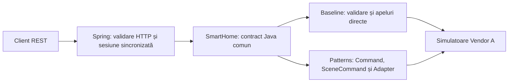

# Notă de progres — Smart Home, Sprint 1

**Review: 16 noiembrie 2026.** Commit verificat: `1d0f425dbd03aa312109cc20bfc5845542bf412e`.

Am livrat un simulator Java 21 cu două implementări ale aceleiași case, accesibile prin același API REST. Ambele pot controla becul și termostatul și executa scene plate în ordine. Când o comandă din scenă este invalidă, clientul primește codul și indexul comenzii, iar starea casei rămâne neschimbată. [Demo-ul](demo-sprint-1.md) arată aceste rezultate pe ambele implementări, pornite din același JAR.

`./mvnw clean verify` a trecut cu **291 de teste** și zero erori, eșecuri sau teste sărite. Suita Java rulează aceleași cazuri pe ambele implementări, iar suita HTTP pornește servere pentru ambele variante și reutilizează cererile JSON de referință. Guard-ul S1-10 verifică importurile și dependențele directe dintre module; [matricea de testare](testing.md) descrie acoperirea și limitele.

## Arhitectura pe care o demonstrăm

Serverul tratează transportul și captează starea sub același lock ca execuția; fiecare proces își alege o singură variantă la pornire. Implementările împart contractul și simulatoarele, iar fiecare își păstrează propria orchestrare:

| Element | Ce rezolvă în patterns | Echivalent în baseline |
| --- | --- | --- |
| Adapter | `VendorALightAdapter` ascunde enum-ul Vendor A; `VendorAThermostatAdapter` traduce gradele Celsius în deci-grade întregi. | Engine-ul apelează simulatoarele și face conversiile direct. |
| Command | Comenzile pentru bec și termostat încapsulează dispozitivul și valoarea pe care o vor aplica. | Engine-ul alege ramura după tipul cererii și apelează simulatorul. |
| Composite plat | `SceneCommand` implementează aceeași interfață ca o comandă individuală și execută lista deja validată. | Engine-ul parcurge lista o dată pentru validare și o dată pentru execuție. |

Mai sunt integrate **Singleton și Proxy** pentru membrii gospodăriei (#20): registrul comun de membri și controlul accesului sunt verificate în teste, fără autentificare în API-ul demo. Commitul include și primul flux **Observer** din S2 (#25): trecerea de la lipsa mișcării la mișcare aprinde becul printr-un listener în patterns și prin logică directă în baseline. Fluxul de mișcare este în exemplele HTTP, dar rămâne în afara secvenței și a benchmark-ului S1.

## Măsurători inițiale

Rulare din 15 noiembrie 2026, ~14:10 (București), macOS 15.7.7 aarch64, OpenJDK 21.0.11 Homebrew, 14 procesoare logice disponibile JVM. `java -jar benchmarks/target/smart-home-benchmarks.jar` a rulat din rădăcina repo, după un build cu checkout curat la commitul de mai sus. Raportul runtime confirmă `commitDirty: false`; LOC citește SHA din `.git` și nu calculează flagul de modificări. Rapoarte originale: [LOC](results/sprint-1/loc.json), [runtime cu runde și ordine](results/sprint-1/runtime.json).

| Măsură | Baseline | Patterns | Comun |
| --- | ---: | ---: | ---: |
| Linii fizice cu cod Java în producție | 233 (4 fișiere) | 440 (17 fișiere) | 177 (14 fișiere) |
| Bec on/off, mediană ns/comandă | 7,61 | 7,48 | — |
| Temperatură, mediană ns/comandă | 5,83 | 64,17 | — |
| Scenă mixtă, mediană ns/scenă | 12,60 | 90,37 | — |

Contorul exclude liniile goale, liniile doar cu comentarii, testele și serverul. Pentru fiecare flux, runner-ul a încălzit JVM cu 200.000 de pași, apoi a cronometrat 10 runde × 1.000.000 de pași per implementare. Rundele pornesc cu instanțe noi, alternează ordinea implementărilor și verifică starea finală în afara cronometrării. Timpul măsoară bucla cu apeluri directe, fără REST sau Spring.

**Constatări.** Varianta patterns are mai multe linii și fișiere. În această rulare, intervalele pe runde se suprapun pentru bec (baseline 5,61–22,10 ms, patterns 6,12–7,80 ms per rundă). Baseline a avut mediane mai mici pentru temperatură și scene. LOC include și codul integrat pentru Household și mișcare, deși acele fluxuri nu sunt cronometrate.

**Ipoteze de verificat în S2.** Obiectele de comandă și delegarea prin adaptoare pot contribui la diferențele de timp; nu am măsurat alocări sau făcut profiling. O singură mașină și o singură rulare nu separă efectele JIT, GC și încărcarea sistemului. Rezultatele nu stabilesc o superioritate generală și nu măsoară costul unei modificări ulterioare.

## Puncte pentru review și continuare

- Bogdan: pornește ambele variante, explică simulatorul, adaptorul și testul de separare (#18, #19, #23).
- Diana: explică de ce o scenă este validată integral și arată diferența dintre respingerea HTTP și cea din engine (#21, #22).
- Ionuț: explică Singleton/Proxy, apoi unde se conectează Observer-ul pentru mișcare (#20, #25).
- Vlad: explică ce numără LOC, ce cronometrează runner-ul și de ce datele brute contează (#24).

Următorii pași sunt în [planul S2](plan.md#pornire-s2). Un punct de documentat înainte de comparațiile viitoare: commitul trebuie fixat și pentru codul numărat, și pentru JAR-ul cronometrat. Dacă diferă sau buildul este modificat, rezultatul nu intră în comparație.
